# Cafe Management System

## Overview
A Python command-line application that helps a small cafe manage its menu, take orders,
generate bills and analyse sales. Data is stored in JSON files so it is not lost when the
program closes.

## Features
- **Menu Management** – add, remove, update price, display (case-insensitive search)
- **Order Processing** – customer details, multiple items, quantity validation
- **Billing & Reports** – bill with GST, total revenue, item-wise sales, best seller
- Persistent storage (JSON), logging (`logs/cafe.log`), input validation, unit tests

## Technologies Used
- Python 3.8+ (standard library only: `json`, `logging`, `re`, `datetime`, `unittest`)
- Git & GitHub for version control

## Project Structure
```
cafe_management_system/
├── main.py              # entry point
├── cafe/
│   ├── config.py        # paths and constants
│   ├── logger.py        # logging setup
│   ├── validators.py    # input validation
│   ├── storage.py       # JSON read/write
│   ├── menu.py          # Module 1: menu management
│   ├── orders.py        # Module 2: order processing
│   ├── billing.py       # Module 3: bill generation
│   ├── reports.py       # Module 3: sales analytics
│   └── cli.py           # user interface / workflow
├── tests/               # unit tests
├── data/                # menu.json, orders.json (auto-created)
├── logs/                # cafe.log (auto-created)
├── docs/design.md       # diagrams and requirements
├── statement.md
└── README.md
```

## How to Install and Run
1. Install Python 3.8 or higher.
2. Clone the repo: `git clone <your-repo-url>` and `cd cafe_management_system`
3. Run: `python main.py`

No extra libraries need to be installed.

## How to Run Tests
```
python -m unittest discover -s tests -t .
```

## Sample Usage
```
Enter your choice (1-7): 5
Enter your name: Riya Sharma
Enter your 10-digit phone number: 9876543210
Enter an item to order (or 'done' to finish): coffee
Enter the quantity: 2
```

## Screenshots

### Main Menu
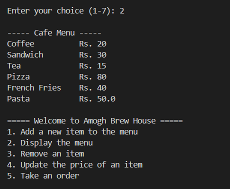

### Display Menu
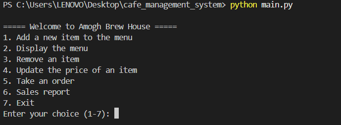

### Sales Report
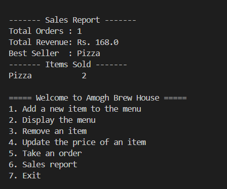

### Take Order
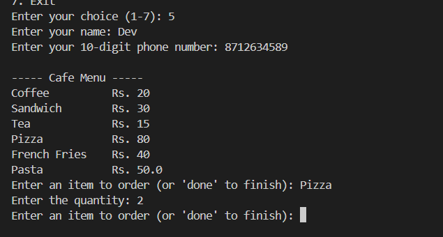

### Unit Tests
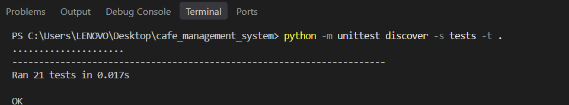

### Bill
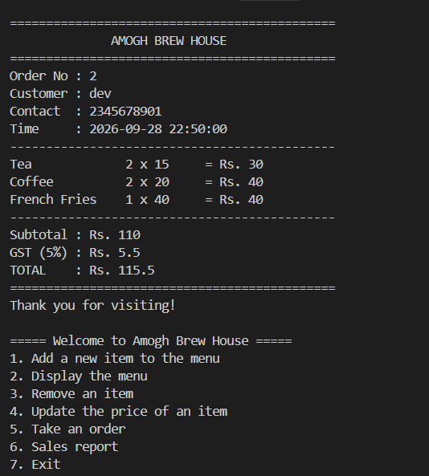


## Design Diagrams

### System Architecture
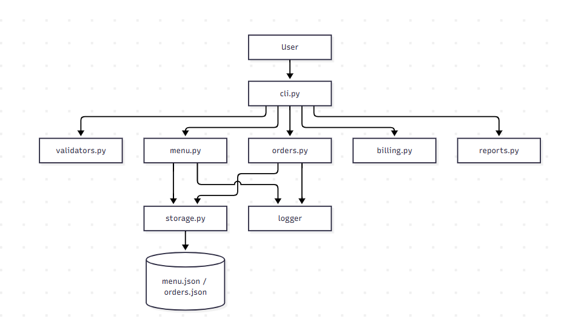

### Workflow
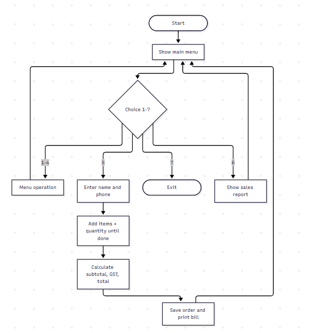

### Class Diagram
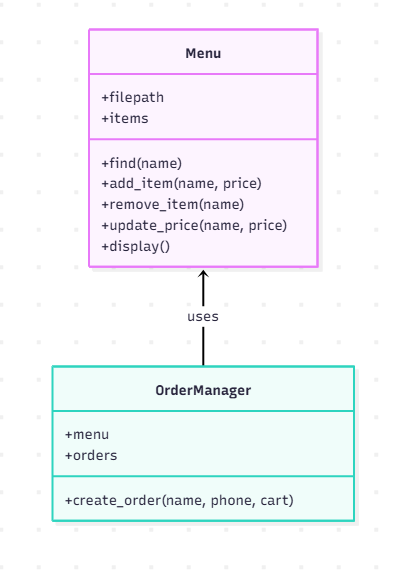

### Sequence
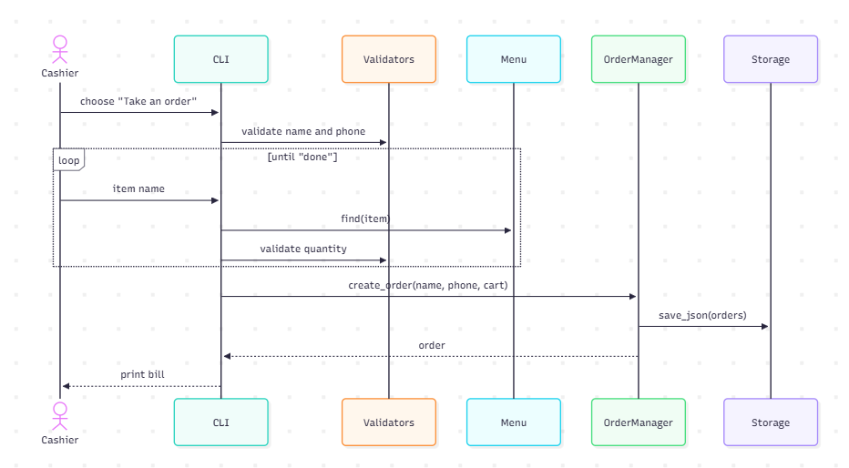

### Storage Design
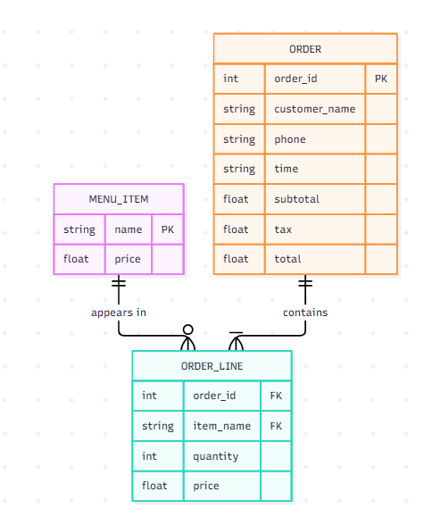

### Use Case
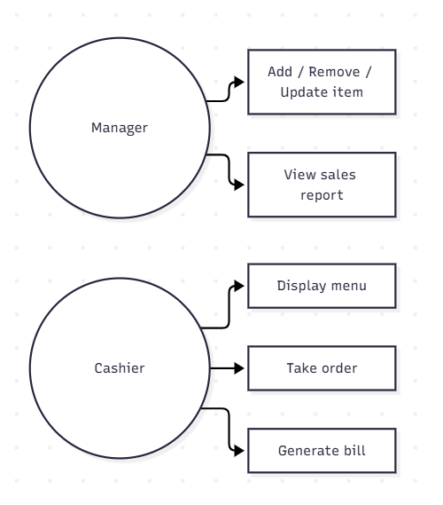